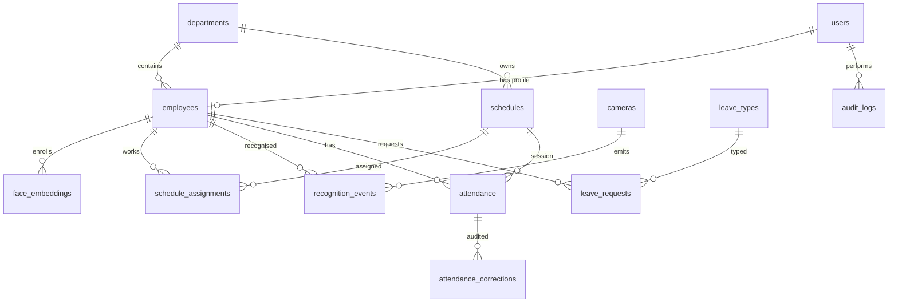

# Database

Key constraints: `attendance (employee_id, schedule_id, work_date)` UNIQUE; `recognition_events (camera_id, event_uuid)` UNIQUE;
`schedules` CHECK end_time > start_time; `leave_requests` CHECK end_date >= start_date.
Recognition events and attendance are separate tables; one employee may produce many events but one row per session per day.

Retention: face embeddings are deleted on deactivation or consent withdrawal; recognition events after `EVENT_RETENTION_DAYS`.
